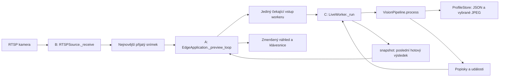

# Jak číst a převzít EDGE kód

Tento průvodce popisuje aplikační kód v `edge/` po úpravě 10. 11. 2026.
Čti nejdřív `edge/main.py`, potom `vision/live.py` a `vision/pipeline.py`.
Detaily modelů, trackingu a ukládání si otevři až podle konkrétního volání.
Historické pokusy a testy jsou po úklidu archivované v
`TRASH/edge-cleanup-2026-11-10/edge/`; hlavní aplikace je nevolá.

## 1. Co přesně spouštíš

Z kořene projektu v PowerShellu:

```powershell
.\edge\.venv\Scripts\python.exe -X utf8 .\edge\main.py
```

Totéž pro balíčkové spuštění:

```powershell
.\edge\.venv\Scripts\python.exe -X utf8 -m edge.main
```

VS Code F5 / Ctrl+F5 používá konfiguraci `EDGE: aplikace` a stejný `edge/main.py`.
Příkaz spustí skutečnou aplikaci včetně připojení RTSP streamu kamery.

Python načte importy a definice. Teprve blok `if __name__ == "__main__"`
zavolá `main()`. Ta vytvoří `EdgeApplication()` a zavolá její `run()`.
`SystemExit` předá výsledný kód systému: `0` znamená běžné ukončení, `1` chybu.

**`main.py` nespouští ostatní `.py` soubory jako nové skripty.** Importem získá
jejich třídy/funkce a následně je volá. Program má jeden proces a po úspěšné
přípravě tři vlastní aplikační vlákna. Knihovny modelů mohou mít další interní vlákna.
Backend ani frontend se tímto příkazem nespouštějí.

## 2. Přesné pořadí od zapnutí po první snímek

```text
edge/main.py: if __name__ == "__main__"
└─ main()
   └─ EdgeApplication().run()
      ├─ _prepare_vision()
      │  ├─ config/settings.py: load_settings()         → Settings
      │  ├─ vision/profiles.py: ProfileStore(settings) → načtené lokální profily
      │  ├─ vision/faces.py: FaceProcessor(settings)   → načtené MTCNN a Facenet512
      │  ├─ vision/pipeline.py: VisionPipeline(...)    → postup + FaceTracker
      │  └─ vision/live.py: LiveWorker(...)            → připravený, ještě neběží
      ├─ _open_camera()
      │  ├─ cameras/source.py: RTSPSource(rtsp_url)     → objekt zdroje
      │  └─ source.open()                             → FFmpeg + čtecí vlákno
      │     └─ RTSPSource._receive()                   → SMYČKA B na pozadí
      ├─ _open_preview()
      │  ├─ cv2.namedWindow(), cv2.resizeWindow()      → příprava okna
      │  └─ worker.start()                            → výpočetní vlákno
      │     └─ LiveWorker._run()                      → SMYČKA C na pozadí
      └─ _preview_loop()                              → SMYČKA A v hlavním vlákně
```

`load_settings()` načte `edge/config/.env`; již nastavené prostředí má přednost.
Ověří adresu `CAMERA_RTSP_URL`, nastaví cestu cache vah a vrátí
`Settings`. Samotné načtení konfigurace nevytváří síťové spojení.
`ProfileStore` ověří JSON před připojením kamery; poškozená data odmítne přepsat.
`FaceProcessor` načte modely jednou při startu. Při chybě modelů se stream ještě neotevírá.

Pro jinou RTSP kameru změň pouze `CAMERA_RTSP_URL` a aplikaci znovu spusť.
Cesta streamu závisí na kameře. Proměnná prostředí má přednost před `.env`.
RTSP musí být povolené, dosažitelné a jeho kodek podporovaný místním OpenCV/FFmpeg.
Přístup k videu a nastavení kamery spravuj ručně v jejím rozhraní;
aplikace neposílá příkazy výrobce. USB/MP4 zdroje zatím implementované nejsou.

## 3. Tři souběžné smyčky: kdo komu předává obraz



### A — hlavní vlákno: `EdgeApplication._preview_loop()`

Jeden průchod smyčky:

1. `source.read()` převezme nejnovější snímek od čtečky. Pokud žádný nečeká,
   počká; při odpojení nebo timeoutu vyvolá `StreamError`.
2. `worker.submit(frame, datum_UTC, timestamp)` předá obraz výpočtu. Nečeká na inference.
3. `worker.snapshot()` převezme poslední **dokončený** výsledek, případně chybu.
   Tento výsledek může patřit staršímu snímku než právě zobrazovaný obraz.
4. `_show_preview()` vytvoří menší obraz a vykreslí dostatečně čerstvé popisky.
   Originál nechá beze změny, protože ho může zároveň používat worker.
5. `_handle_input()` obslouží okno. Q / Esc / zavření okna vrací `True` a ukončí
   smyčku. Ostatní klávesy smyčka ignoruje.
6. V intervalu vypíše změřenou četnost náhledu a opakuje celý postup.

### B — čtecí vlákno: `RTSPSource._receive()`

Opakovaně volá `capture.read()`. OpenCV/FFmpeg dekóduje stream do BGR snímků.
Čtečka uloží nový obraz do `self.frame` a probudí čekající `source.read()`.
Pokud předchozí obraz ještě nebyl převzatý, přepíše ho novějším. Neprovádí detekci,
matching ani zápis profilů. Kamera neposílá Python volání; čtečka přijímá její stream.

### C — výpočetní vlákno: `LiveWorker._run()`

`_take_pending()` počká na vstup i na konec povinné pauzy. Vrátí nejnovější
trojici `(frame, observed_at, timestamp)` a uvolní slot. Potom worker:

1. Zavolá `pipeline.process(frame, observed_at, timestamp)` mimo zámek.
2. Publikuje nové `labels` a čas jejich vstupu `published_at`.
3. Vypíše události; občas `_report_metrics()` vypíše naměřené časy a počty.
4. Naplánuje další povolený výpočet na čas dokončení + `process_interval`.

`Condition` chrání sdílené sloty a při čekání uvolňuje zámek. Modely se počítají
mimo zámek, takže hlavní vlákno může dál předávat nové vstupy a kreslit.
Při chybě worker uloží výjimku do `self.error`; hlavní vlákno ji převezme přes snapshot.

**Není zaručeno zpracování každého kamerového snímku.** Existuje nejvýše jeden
čekající snímek ve čtečce a jeden u workeru, navíc právě zpracovávaný obraz.
Například během výpočtu snímku 1 přijdou 2 a 3: čekající 2 se přepíše 3.
Po dokončení 1 dostane worker 3, pokud ho mezitím nenahradil ještě novější vstup.
Pauza 0,25 s je po dokončení výpočtu; neznamená garantované 4 zpracované snímky/s.

## 4. Co se děje s jedním vybraným snímkem

`VisionPipeline.process()` provede tyto kroky:

1. **Detekce** — `FaceProcessor.detect(frame)` zmenší obraz pro MTCNN nejvýše na
   `detection_width`. `_extract_observation()` přepočítá boxy/body do původního
   měřítka a vytvoří výřezy z původních pixelů. Výstupem je seznam `FaceObservation`.
2. **Tracking** — `FaceTracker.update(observations, timestamp)` porovná prostorové
   překryvy boxů. Odstraní prošlé tracky, vyřadí nejasné překryvy a přiřadí detekce.
   Nový track ještě není nový uložený člověk.
3. **Smyčka D pro viditelné obličeje** — pro každou dvojici `(track, observation)`:
   - Track bez `person_id`: `_resolve()` hlídá interval a kvalitu, potom spočítá embedding
     a hledá v galerii. `_confirm_existing()` vyžaduje opakovanou jasnou shodu;
     `_confirm_new()` sbírá konzistentní důkazy před pokusem založit profil.
   - Track s `person_id`: `_improve_known()` aktualizuje `last_seen`. V intervalu
     zkontroluje kvalitu a `store.wants_sample()`. Embedding počítá až pro vzorek,
     který by mohl zlepšit profil; používá přímo známou osobu bez hledání galerie.
4. **Výsledek** — vytvoří popisky pro náhled, události pro terminál a zavolá `store.flush()`.
   Vrátí jeden `PipelineResult(labels, events)` workeru.

Výchozí pravidla pro neznámý track: 2 jasné shody se stejnou existující osobou,
nebo 3 kvalitní konzistentní embeddingy bez shody před pokusem založit novou osobu.
Nejasná shoda založení odloží. Další ověření v `observe()` může najít profil,
který mezitím založil jiný track. Prahy jsou heuristiky, přesnost není změřená.

`FaceProcessor.evaluate()` ukládá slovník kvality do pozorování, takže se pro
stejný výřez nepočítá podruhé. `quality.evaluate_face()` posuzuje velikost, ostrost,
jas a confidence, `estimate_view()` hrubý pohled a `image_fingerprint()` dHash.
Embedding vytváří `FaceProcessor.embed()` přes Facenet512, nikoli MTCNN.
Pomocné `FaceProcessor.process()` živá pipeline nevolá; používá jednotlivé kroky odděleně.

## 5. Co a kdy se ukládá

`ProfileStore` drží paměťový dokument `{"profiles": [...]}` a mapu `indexes`.
Jeden proces je vlastníkem úložiště; do JSON zapisuje worker a po jeho ukončení main.

```text
observe() nebo update_person()
└─ _save_observation()
   ├─ _prepare_profile()         → nový profil nebo pracovní kopie známého
   ├─ _replacement()             → slot pro přidání/náhradu, nebo None
   │  └─ _extra_replacement()    → výběr doplňku, pokud nerozhodl hlavní pohled
   ├─ připravit vzorek, role a representative_image
   ├─ _commit_profile()
   │  └─ _write_sample()         → nový JPEG, potom _write() pro JSON
   │     └─ _write()             → dočasný JSON, pak nahrazení původního souboru
   └─ _remove_replaced_sample()  → starý JPEG odstranit až po úspěšném zápisu
```

`slot = None` znamená, že identitu můžeme znát, ale nechceme další fotografii.
Uchovávají se nejvýše tři hlavní pohledy a dva doplňky, celkem nejvýše 5 vzorků.
Při selhání zápisu se nový JPEG uklidí a původní vzorky zůstanou zachované.
`touch()` mění pouze `last_seen` a příznak `dirty`; `flush()` ukládá změněné časy
nejvýše po stanoveném intervalu. Vybraný nový vzorek se ukládá hned.

`match()` porovnává nový embedding se všemi vzorky osob. Pro každou osobu vezme
nejmenší cosine distance a seřadí osoby od nejlepší. Shoda musí projít prahem
a mít dostatečný odstup od druhé osoby. Cosine distance není procento jistoty.

## 6. Složitější proměnné a jejich tvary

| Proměnná / typ | Přesný význam |
| --- | --- |
| `self` | Aktuální instance třídy; `self.source` je stav této aplikace. |
| `settings` | `Settings`, společné neměnné nastavení; položky mají komentáře v `config/settings.py`. |
| `frame`, `crop`, `display` | NumPy pole `[výška, šířka, 3]` v BGR. Celý vstup / výřez obličeje / samostatný náhled. |
| `box`, `(x, y, w, h)` | Levý horní roh a šířka/výška v původních pixelech, nikoli dvojice rohů. |
| `x1`, `y1`, `x2`, `y2` | Rohy oříznuté hranicemi obrazu; dolní/pravá hranice se do Python řezu nezahrnuje. |
| `scale_x`, `scale_y` | Násobky přepočtu souřadnic; u detektoru zpět na originál, u náhledu do menšího obrazu. |
| `observation` | `FaceObservation`: výřez, box, confidence, body tváře a případně již spočtená kvalita. |
| `candidate` | `FaceCandidate`: výřez, box, kvalita a hotový embedding. |
| `keypoints` | Mapa jména bodu → `(x, y)`, např. `nose`, `left_eye`, `right_eye`. |
| `quality` | Slovník `score`, `usable`, `width`, `height`, `sharpness`, `confidence`, `view`, `fingerprint`. |
| `score`, `usable` v kvalitě | Heuristické skóre 0–1 a bool splnění všech podmínek kvality. |
| `view` | `left/front/right/unknown`; hrubý odhad ve směru obrazu, nikoli měřený úhel hlavy. |
| `fingerprint` | 64bitový dHash jako 16 hex znaků. Porovnává vzhled fotografií. |
| `embedding`, `vector` | Číselný popis tváře; pro Facenet512 má 512 hodnot. `vector` bývá NumPy podoba pro výpočet/validaci. |
| `now`, `observed_at` v pipeline/store | Skutečný `datetime` v UTC pro časy v JSON. |
| `timestamp`, `published_at` | `monotonic()` sekundy pro intervaly / čas vstupu posledního hotového výsledku. Nejsou kalendářní datum. |
| `now` v trackeru | Monotonic sekundy, na rozdíl od `now` v úložišti; význam je uvedený u metod. |
| `track_id`, `person_id` | Dočasné číslo sledování v tomto běhu / trvalé místní ID profilu `person-0001`. |
| `tracks` | Mapa `track_id → Track`, pouze v paměti. Ztráta tracku neprokazuje odchod člověka. |
| `evidence`, `match_person`, `match_votes` | Dočasné embeddingy nové osoby / kandidát známého ID / počet potvrzujících shod. |
| `next_recognition`, `next_quality` | Nejbližší povolený monotonic čas dalšího výpočtu příslušného kroku. |
| `missed_since`, `last_seen` v Track | Začátek skutečně chybějící detekce / čas poslední přiřazené detekce. |
| `scores`, `possible` v trackeru | Mapa `(track_id, index detekce) → IoU`; druhá obsahuje jen dvojice nad prahem. |
| `ambiguous_tracks`, `blocked_observations` | ID nejasných tracků / indexy detekcí, které se při nejasnosti nesmějí přiřadit. |
| `assigned`, `assigned_tracks`, `assigned_observations` | Přiřazení indexu na track / použitá ID / použité indexy detekcí. |
| `scores` ve store | Seřazené dvojice `(nejlepší distance osoby, index profilu)`; význam se liší od trackeru. |
| `index`, `indexes` ve store | Pozice osoby v seznamu / mapa `person_id → index`. |
| `distance`, `ambiguous` v matchingu | Cosine distance nejlepší přijaté shody / nedostatečný odstup druhé osoby. |
| `samples`, `primary`, `extras` | Vzorky profilu / mapa hlavního pohledu na index vzorku / indexy doplňků. |
| `near_duplicates`, `duplicate_extras` | Indexy podobných fotek stejného pohledu / jejich část patřící mezi doplňky. |
| `slot`, `previous`, `entry` ve store | Index přidání/náhrady / cesta nahrazované fotky / nový slovník vzorku. |
| `relative`, `file`, `directory` | Relativní cesta v JSON / ověřená absolutní cesta fotografie / složka osoby. |
| `profile`, `updated`, `self.data` | Pracovní profil / kopie budoucího celého dokumentu / přijatý dokument v paměti. |
| `dirty`, `last_flush` | Neuložená změna časů / UTC datum posledního zápisu. |
| `pending` ve workeru | Jediná čekající trojice `(frame, observed_at, timestamp)`, nebo None. |
| `condition`, `thread` | Zámek s čekáním/probouzením / objekt vlastního vlákna. |
| `labels`, `events` | Popisky `[(box, text)]` / události změn identity a vzorků. |
| `stats`, `previous`, `delta` v metrikách | Kumulativní čítače / jejich minulá kopie / přírůstky za interval. |
| `dropped` | Celkový počet přepsaných čekajících snímků workeru; nezahrnuje přepisy v RTSP čtečce. |
| `stage`, `exit_code` | Fáze pro hlášení chyby / konečný stav běhu 0 nebo 1. |

`PipelineResult`, `WorkerSnapshot` a `MatchResult` jsou `NamedTuple`: jeden logický
výsledek s pojmenovanými položkami. Zachovávají původní rozbalení i indexování.
Například `result.labels` je stejný obsah jako první položka dvojice z pipeline.
Metody provádějící příkaz běžně vracejí `None`. Více předčasných `return` větví
znamená různé možné výsledky jednoho volání, nikoli několik současných výstupů.
Jednoduché výpočty zůstávají funkcemi; nepotřebují třídu bez vlastního stavu.

## 7. Ukončení a místa, kde začít při úpravách

`run()` má `finally: _shutdown()`, tedy úklid i po chybě nebo Ctrl+C:

1. `_close_source()` zastaví příjem RTSP.
2. `_close_worker()` zahodí čekající vstup a počká na právě běžící výpočet.
3. `_flush_store()` vynutí zápis změněných časů, až když je worker přestal měnit.
4. Zavřou se okna OpenCV. Kamera se fyzicky nevypíná.

Násilné ukončení procesu nebo výpadek napájení tento úklid nezaručuje.
Automatický reconnect streamu není implementovaný.

| Chci změnit / pochopit | Začnu zde |
| --- | --- |
| Pořadí startu, náhled, klávesnici, ukončení | `edge/main.py`, třída `EdgeApplication` |
| Adresu kamery a číselné prahy | Lokální `edge/config/.env` a `config/settings.py` |
| Příjem a odpojení videa | `cameras/source.py`, `RTSPSource` |
| Předávání snímků, pauzy a metriky | `vision/live.py`, `LiveWorker` |
| Pořadí zpracování a potvrzení identity | `vision/pipeline.py`, `VisionPipeline` |
| MTCNN, výřezy a Facenet512 | `vision/faces.py`, `FaceProcessor` |
| Kvalitu fotky, odhad pohledu a dHash | `vision/quality.py` |
| Track ID, IoU a prostorové přiřazení | `vision/tracking.py`, `FaceTracker` |
| Matching, výběr vzorků a bezpečné uložení | `vision/profiles.py`, `ProfileStore` |

Pro krokování nastav breakpoint do `_preview_loop()` za `source.read()`,
do `VisionPipeline.process()` a potom do `_resolve()` / `_improve_known()`.
Debugger ukazuje různé zásobníky pro jednotlivá vlákna; pozastavení ovlivní jejich časování.

Před úklidem 10. 11. 2026 prošlo 51 simulovaných testů bez připojení kamery.
Testy jsou nyní v `TRASH/edge-cleanup-2026-11-10/edge/tests/` s příponou
`.py.disabled`. Návod k obnovení je v README stejného archivu.
Po obnovení do `edge/tests/` je spustíš takto:

```powershell
.\edge\.venv\Scripts\python.exe -B -X utf8 -m unittest discover -s edge/tests -q
```

Tyto testy ověřují logiku a simulované chyby. Funkčnost fyzické kamery,
přesnost rozpoznávání a skutečné FPS vyžadují samostatné živé ověření.
